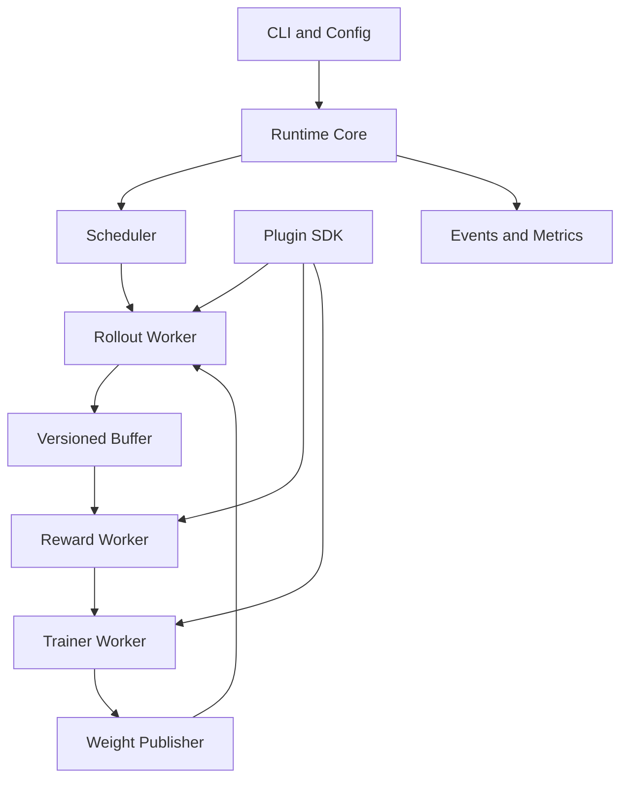

# ForgeRL 项目设计与个人开发规划

---

```yaml
project: ForgeRL
description: 可扩展且具备策略版本感知能力的 LLM 强化学习训练运行时
owner: 侯芃泽
development_mode: 单人开发
status: planning
document_version: 0.1
start_date: 2026-09-29
target_v0_1: 2026-11-23
target_v1_0: 2027-01-18
weekly_budget: 15 hours
primary_language: Python
primary_hardware:
  - NVIDIA Tesla T4 15GB
  - NVIDIA GeForce RTX 4060 8GB
```

## 1 项目概述

ForgeRL 是一个面向大语言模型强化学习训练的轻量级运行时。它负责组织 Rollout、奖励计算、轨迹处理、策略训练、权重发布、Checkpoint 和性能观测，并通过插件接口允许第三方扩展算法、奖励函数、推理后端、训练后端和调度策略。

项目聚焦单机环境，优先解决有限 GPU 资源下的两个实际问题：

1. 如何将原本串行执行的 Rollout 和训练阶段组织成可观测、可恢复的流水线。
2. 当 Rollout 和训练并行执行时，如何记录策略版本、识别过期轨迹并控制异步训练带来的数据陈旧问题。

最终交付物不是一个只能运行固定 GRPO 脚本的实验仓库，而是一套小而完整的 RL Infra 系统。第三方开发者应当能够在不修改 ForgeRL 核心代码的情况下安装新的插件，并通过统一命令运行和验证插件。

本项目由一人完成。开发计划遵循“先完成正确闭环，再建立扩展协议，最后优化系统性能”的顺序。第一阶段不追求支持大量算法和模型，而是确保每个已经声明支持的能力都有测试、文档、错误处理和可复现实验。

## 2 项目目标

### 2.1 核心目标

- 在 0.5B 级开源语言模型上完成一套可运行的 GRPO 训练闭环。
- 支持 Mock、单 GPU 分时复用、双 GPU 分离同步和双 GPU 有界异步四种运行模式。
- 建立稳定的数据协议，统一描述生成请求、轨迹、奖励、训练批次、权重快照和运行事件。
- 提供第三方插件机制，允许外部 Python 包扩展核心能力。
- 实现策略版本管理、轨迹陈旧度判断、队列背压和过期数据统计。
- 实现 Checkpoint、进程心跳、故障检测和训练恢复。
- 使用 NVTX、PyTorch Profiler 和 Nsight Systems 分析端到端性能。
- 建立自动化测试、性能基准、插件一致性测试和技术文档。

### 2.2 简历目标

项目完成后，应当能够用真实数据说明以下问题：

- 同步模式和异步模式的端到端吞吐差异。
- Rollout、训练、权重同步和队列等待分别占用多少时间。
- 不同最大策略版本差对吞吐、轨迹丢弃率和训练效果的影响。
- Worker 异常退出后，运行时如何恢复以及损失了多少工作。
- 一个外部开发者如何在不修改核心仓库的前提下实现并安装插件。

项目的竞争力来自可以检查的代码、Trace、测试和实验结果，而不是功能列表。最终 README、技术报告和简历描述中不得填写未经测量的性能数字。

### 2.3 教学与课程目标

老师要求项目具有可扩展性，因此最终验收必须包含一个独立于主仓库的第三方插件包。该插件通过 Python 包管理机制安装，由 ForgeRL 自动发现，并通过官方一致性测试。仅在主仓库中预留抽象类但没有外部插件实例，不算完成可扩展性要求。

## 3 项目范围

### 3.1 v1.0 包含的能力

| 能力 | v1.0 要求 |
| --- | --- |
| 强化学习算法 | 完整支持 GRPO；为 PPO 或 RLOO 保留接口并至少实现一个外部示例插件 |
| 模型规模 | 以 0.5B 级模型为主，不承诺 7B 及以上模型 |
| 奖励 | Exact Match、格式奖励和第三方奖励插件 |
| Rollout | Mock、Transformers、vLLM |
| 训练 | PyTorch 单卡 LoRA；双卡实验阶段可加入 DDP 或 FSDP2 |
| 调度 | FIFO、长度感知组批、有界异步队列 |
| 部署范围 | 单机单 GPU和单机多 GPU |
| 容错 | Worker 心跳、超时、失败状态、Checkpoint 和手动恢复 |
| 观测 | 结构化日志、指标、NVTX 标注、性能报告 |
| 扩展 | Python entry points 自动发现和独立插件包 |

### 3.2 明确不做的内容

以下内容不属于 v1.0 范围：

- 多节点集群和 Kubernetes 部署。
- Megatron-LM、Tensor Parallel 和 Pipeline Parallel。
- 7B 以上模型训练。
- Reward Model 训练和复杂人类偏好数据管线。
- Agent、工具调用和多轮环境交互。
- 自研 PagedAttention 或完整推理引擎。
- 同时实现 PPO、GRPO、DAPO、RLOO 等大量算法。
- Web 管理后台和大屏监控。
- 在没有 Profiling 证据的情况下编写自定义 CUDA Kernel。
- 将 OPD 经历或教师模型蒸馏作为项目主线。

这些限制用于保证一人能在 16 周内交付完整系统。后续扩展必须在 v1.0 的正确性、测试和文档完成后再进入 Roadmap。

## 4 目标用户与典型场景

### 4.1 目标用户

- 希望理解 LLM RL 训练系统内部流程的学生和研究者。
- 希望验证新奖励函数或新算法，但不想重新编写运行时的开发者。
- 希望比较同步和异步训练性能的系统研究者。
- 希望在有限 GPU 上进行小模型 RL 实验的个人开发者。

### 4.2 典型使用流程

```bash
# 安装 ForgeRL
pip install -e .

# 查看可用插件
forgerl plugin list

# 验证配置和插件兼容性
forgerl config validate configs/grpo_qwen_0_5b.yaml
forgerl plugin test exact_match

# 启动训练
forgerl run --config configs/grpo_qwen_0_5b.yaml

# 从 Checkpoint 恢复
forgerl resume outputs/run_001/checkpoints/latest

# 生成性能对比报告
forgerl benchmark compare outputs/sync outputs/async
```

### 4.3 第三方扩展流程

```bash
# 安装外部插件，插件不位于 ForgeRL 主仓库
pip install forgerl-example-reward

# ForgeRL 自动发现插件
forgerl plugin inspect example_math_reward

# 运行一致性测试
forgerl plugin test example_math_reward

# 在配置中直接引用
forgerl run --config configs/external_reward.yaml
```

## 5 总体架构

ForgeRL 采用微内核和插件架构。Runtime Core 只负责通用的执行、调度、状态管理和错误处理，不包含 GRPO、vLLM 或 Exact Match 的专用分支。具体算法和后端均通过 SDK 接口接入。



### 5.1 控制面

控制面处理不包含大张量的低频消息：

- 插件发现、加载和版本检查。
- Worker 创建、启动、停止和重启。
- 运行状态转换。
- 心跳、超时和错误传播。
- 任务分派和队列背压。
- Checkpoint 协调。
- 指标和事件上报。

第一版使用 `torch.multiprocessing` 管理进程，使用 `Queue` 或 `Pipe` 传输控制消息。控制消息必须是带类型的数据类，禁止在核心路径中传递结构不明的字典。

### 5.2 数据面

数据面传输模型输入、生成结果、轨迹、训练批次和权重。实现顺序如下：

1. v0.1 使用 CPU Tensor 和进程队列保证正确性。
2. v0.2 对大 Tensor 使用共享内存或 pinned memory，减少序列化复制。
3. v0.3 在双 GPU 模式下使用 `torch.distributed` 和 NCCL 进行必要的张量或权重传输。

每次优化前必须保留可工作的慢速实现作为正确性基线。

### 5.3 进程角色

| 角色 | 主要职责 | 是否持有模型 |
| --- | --- | --- |
| Coordinator | 生命周期、任务调度、状态和错误处理 | 否 |
| Rollout Worker | 接收 Prompt、生成回答、记录旧策略 Logprob | 是 |
| Reward Worker | 计算规则奖励或调用奖励插件 | 通常否 |
| Trainer Worker | 计算 Advantage、Loss、反向传播和优化器更新 | 是 |
| Weight Publisher | 发布新的策略版本和权重快照 | 可与 Trainer 合并 |
| Metrics Collector | 聚合事件、指标和 Trace 元数据 | 否 |

## 6 运行模式

### 6.1 Mock 模式

Mock 模式不加载真实语言模型，用于验证插件、状态机、数据协议、Checkpoint 和故障恢复。它必须可以在 CPU CI 环境运行，并在数分钟内完成全部集成测试。

### 6.2 单 GPU 分时复用模式

适用于 Tesla T4 15GB。一个训练 Step 按以下顺序执行：

```text
Rollout
  -> 释放或休眠 Rollout Engine
  -> Trainer 加载训练状态
  -> GRPO Update
  -> 发布新权重版本
  -> Rollout Engine 恢复并加载新权重
```

该模式是 v0.1 的真实模型基线。它不追求 Rollout 和训练并行，但必须记录各阶段耗时和峰值显存，为后续优化提供数据。

### 6.3 双 GPU 分离同步模式

```text
GPU 0: Rollout Worker
GPU 1: Trainer Worker
```

Trainer 在完成当前批次训练后发布新权重，Rollout Worker 加载新版本后才生成下一批数据。该模式用于建立异步实验的公平基线。

### 6.4 双 GPU 有界异步模式

Rollout 和 Trainer 并行工作。每批轨迹记录生成它的策略版本，Trainer 根据陈旧度决定接收或丢弃。

设当前 Trainer 策略版本为 `v_current`，轨迹版本为 `v_trajectory`：

```text
staleness = v_current - v_trajectory
```

支持三种策略：

| 策略 | 接收条件 | 作用 |
| --- | --- | --- |
| strict | `staleness == 0` | 最接近同步语义，可能产生更多等待 |
| bounded | `staleness <= max_staleness` | 在吞吐和数据新鲜度之间折中 |
| drop | 超出阈值时丢弃 | 防止旧数据无限堆积 |

必须记录旧轨迹占比、丢弃 Token 数、队列长度和 GPU 等待时间。项目不预设异步模式一定更好，最终结论以实验结果为准。

## 7 插件系统

### 7.1 依赖方向

```text
第三方插件  ---> ForgeRL SDK
内置插件    ---> ForgeRL SDK
Runtime     ---> ForgeRL SDK

Runtime Core -X-> 具体插件实现
```

核心代码不得出现以下结构：

```python
if algorithm_name == "grpo":
    ...
elif rollout_backend == "vllm":
    ...
```

核心只能通过 Registry 获取满足指定 Protocol 的实例。

### 7.2 插件类型

#### AlgorithmPlugin

负责声明算法所需角色、将轨迹转为训练批次并计算算法损失。它不负责创建进程、选择 GPU 或保存 Checkpoint。

```python
class AlgorithmPlugin(Protocol):
    name: str
    api_version: str

    def required_roles(self) -> set[ModelRole]: ...

    def postprocess(
        self,
        trajectories: TrajectoryBatch,
        services: AlgorithmServices,
    ) -> TrainBatch: ...

    def compute_loss(
        self,
        batch: TrainBatch,
        models: ModelCollection,
    ) -> LossOutput: ...
```

#### RewardPlugin

负责从生成结果计算 Sequence-level 或 Token-level Reward。

```python
class RewardPlugin(Protocol):
    name: str
    api_version: str

    def initialize(self, context: PluginContext) -> None: ...

    def compute(self, batch: GenerationBatch) -> RewardOutput: ...

    def shutdown(self) -> None: ...
```

#### RolloutBackend

负责模型生成、权重加载和健康检查。

```python
class RolloutBackend(Protocol):
    name: str

    def initialize(self, config: RolloutConfig) -> None: ...

    def generate(
        self,
        requests: list[GenerateRequest],
    ) -> GenerationBatch: ...

    def load_weights(self, snapshot: WeightSnapshot) -> None: ...

    def health(self) -> WorkerHealth: ...

    def shutdown(self) -> None: ...
```

#### TrainerBackend

负责模型初始化、优化器更新、梯度缩放和训练状态导入导出。v0.1 只实现单卡 PyTorch 后端，FSDP2 属于后续扩展。

#### SchedulerPolicy

负责决定下一个执行任务、Batch 组成和队列优先级。调度器只读取资源状态和任务元数据，不直接访问模型。

#### Callback

Callback 用于日志、评估和指标导出。Callback 的失败默认不能中断训练，除非配置为 `critical=true`。

### 7.3 插件发现

第三方插件通过 `pyproject.toml` 注册：

```toml
[project.entry-points."forgerl.reward"]
example_math_reward = "forgerl_example.reward:MathReward"

[project.entry-points."forgerl.algorithm"]
rloo = "forgerl_rloo.algorithm:RLOOAlgorithm"
```

ForgeRL 使用 `importlib.metadata.entry_points()` 发现插件。插件加载流程为：

```text
discover
  -> inspect metadata
  -> validate API version
  -> validate configuration
  -> initialize
  -> health check
  -> execute
  -> shutdown
```

### 7.4 插件兼容性

每个插件必须声明：

- 插件名称和版本。
- ForgeRL SDK API 版本。
- 所需能力和可选能力。
- 配置 Schema。
- 是否支持 Checkpoint。
- 是否支持多进程。
- 是否要求 GPU。

不兼容插件必须在训练启动前失败，不能运行数小时后才暴露接口错误。

## 8 数据协议

### 8.1 设计原则

- 核心路径使用 `dataclass`、`TypedDict` 或 Pydantic Model，不使用无约束字典。
- 每个 Tensor 字段必须说明 Shape、Dtype、Device、Mask 和 Padding 语义。
- 数据结构包含 `schema_version`，为后续兼容升级提供依据。
- 大对象和控制消息分开传输。
- 序列化后必须能够在 CPU Mock 环境恢复。

### 8.2 TrajectoryBatch

```python
@dataclass
class TrajectoryBatch:
    schema_version: str
    request_ids: list[str]
    group_ids: Tensor
    prompt_ids: Tensor
    response_ids: Tensor
    attention_mask: Tensor
    response_mask: Tensor
    old_logprobs: Tensor
    sequence_rewards: Tensor | None
    policy_version: int
    metadata: dict[str, JsonValue]
```

字段约束：

| 字段 | Shape | 语义 |
| --- | --- | --- |
| `group_ids` | `[B]` | 标识同一 Prompt 对应的多个采样 |
| `prompt_ids` | `[B, P]` | Padding 后的 Prompt Token |
| `response_ids` | `[B, R]` | Padding 后的生成 Token |
| `attention_mask` | `[B, P + R]` | 模型前向使用的完整 Mask |
| `response_mask` | `[B, R]` | 只标记参与 RL Loss 的 Response Token |
| `old_logprobs` | `[B, R]` | 生成策略对已采样 Token 的 Log Probability |
| `sequence_rewards` | `[B]` | 每条回答的序列级奖励 |
| `policy_version` | Scalar | 生成整个 Batch 的策略版本 |

一个 `TrajectoryBatch` 只能包含同一策略版本的数据。异步 Buffer 可以同时存放多个版本的 Batch，但不得在没有显式记录的情况下混合。

### 8.3 WeightSnapshot

```python
@dataclass
class WeightSnapshot:
    policy_version: int
    format: Literal["full", "lora", "sharded"]
    uri: str | None
    checksum: str
    metadata: dict[str, JsonValue]
```

v0.1 使用文件或内存中的 LoRA 权重快照；后续版本再增加直接 GPU 到 GPU 传输。每次加载必须校验版本号和校验和，避免 Rollout Worker 错误标记策略版本。

### 8.4 RuntimeEvent

所有重要状态变化写入结构化事件：

```python
@dataclass
class RuntimeEvent:
    event_id: str
    event_type: str
    timestamp_ns: int
    run_id: str
    worker_id: str | None
    policy_version: int | None
    payload: dict[str, JsonValue]
```

事件至少包括：

```text
RUN_STARTED
PLUGIN_LOADED
WORKER_STARTED
WORKER_HEARTBEAT
ROLLOUT_COMPLETED
TRAJECTORY_DROPPED
TRAIN_STEP_COMPLETED
WEIGHT_PUBLISHED
CHECKPOINT_STARTED
CHECKPOINT_COMPLETED
WORKER_FAILED
RUN_RECOVERED
RUN_FINISHED
```

## 9 Runtime 状态机

```text
CREATED
  -> VALIDATING
  -> INITIALIZING
  -> RUNNING
  -> CHECKPOINTING
  -> RUNNING
  -> STOPPING
  -> FINISHED

任意运行状态
  -> DEGRADED
  -> RECOVERING
  -> RUNNING 或 FAILED
```

状态转换必须由 Coordinator 统一执行，并生成 RuntimeEvent。Worker 不得自行修改全局运行状态。

### 9.1 错误类型

```text
ConfigurationError
PluginLoadError
PluginCompatibilityError
PluginExecutionError
WorkerTimeoutError
WorkerCrashedError
OutOfMemoryError
WeightSyncError
CheckpointError
ProtocolViolationError
```

所有跨进程异常转换成可序列化的 `ErrorEnvelope`，其中包含错误类型、消息、Worker、阶段、策略版本和可选 Stack Trace。

### 9.2 恢复策略

| 错误 | 默认处理 |
| --- | --- |
| 非关键 Callback 失败 | 记录错误并继续 |
| Reward 单条样本失败 | 标记样本失败并按配置丢弃或赋默认奖励 |
| Rollout 请求超时 | 有限次数重试，超过阈值后失败 |
| Worker 心跳超时 | 标记失联并停止分配新任务 |
| Worker 进程退出 | 当前 v1.0 终止运行并允许从最近 Checkpoint 恢复 |
| CUDA OOM | 记录 Batch 和显存状态，终止当前运行 |
| Checkpoint 写入失败 | 保留上一个完整 Checkpoint，禁止覆盖 latest 指针 |

v1.0 不强制实现完全自动的 Worker 热重启。可靠地检测失败、保存证据并从完整 Checkpoint 恢复，比不稳定的自动重启更重要。

## 10 GRPO 训练闭环

### 10.1 最小训练流程

1. 从数据集读取一组 Prompt。
2. 每个 Prompt 生成 `G` 个回答。
3. Reward Plugin 为每个回答计算序列级奖励。
4. 按 Prompt Group 计算奖励均值和标准差。
5. 计算标准化 Advantage。
6. Trainer 重新计算新策略 Logprob。
7. 计算带 Clip 和可选 KL 的 Policy Loss。
8. 反向传播并更新 LoRA 参数。
9. 增加 `policy_version` 并发布 WeightSnapshot。
10. 写入指标和 Checkpoint。

### 10.2 正确性检查

- 同一个 Group 内 Advantage 均值应接近零。
- `response_mask == 0` 的 Token 不得进入 Loss。
- 当新旧策略完全相同时，Probability Ratio 应接近 1。
- 全部 Reward 相同时，需稳定处理标准差接近零的情况。
- 梯度累积按有效 Response Token 数归一化，避免长度改变 Loss 尺度。
- Old Logprob 必须来自轨迹记录的策略版本，不得使用训练后的当前策略重新生成。
- 训练单步结果应与独立参考实现对齐，误差阈值在测试中明确规定。

## 11 权重同步与版本管理

### 11.1 v0.1 文件式发布

Trainer 将 LoRA 权重保存到临时路径，计算校验和，原子重命名为正式文件，然后更新 Manifest。Rollout Worker 只读取 Manifest 指向的完整版本。

```text
write temporary snapshot
  -> fsync if required
  -> calculate checksum
  -> atomic rename
  -> update manifest
  -> emit WEIGHT_PUBLISHED
```

### 11.2 版本规则

- 初始模型版本为 0。
- 每次成功完成优化器更新后版本加 1。
- 训练失败或梯度被跳过时不得增加版本。
- WeightSnapshot、TrajectoryBatch、Checkpoint 和性能事件使用同一个版本定义。
- Rollout Worker 完成权重加载后才能对外报告新版本。
- Checkpoint 恢复后版本号继续增长，不得从 0 重新开始。

### 11.3 后续优化

在双 GPU 实验中，根据 Profiling 结果选择以下一种方案：

- LoRA Adapter 直接传输。
- CPU pinned memory 中转。
- `torch.distributed.broadcast`。
- 推理后端提供的 Weight Update 接口。

不得同时实现所有方案。选择一种可靠方案作为 v1.0，其他方案记录在 Roadmap。

## 12 Checkpoint 设计

Checkpoint 至少保存：

```text
model or LoRA state
optimizer state
lr scheduler state
grad scaler state
global step
policy version
random number generator states
dataset cursor
sampler state
plugin states
runtime configuration
schema and SDK versions
```

目录示例：

```text
checkpoints/
├── step_000010/
│   ├── manifest.json
│   ├── model/
│   ├── optimizer/
│   ├── runtime_state.json
│   └── plugin_states/
├── step_000020/
└── latest -> step_000020
```

`latest` 只能在新 Checkpoint 完整写入并通过校验后更新。恢复测试必须验证模型、优化器、全局 Step、策略版本、数据位置和随机状态，而不是只验证权重文件存在。

## 13 可观测性与性能指标

### 13.1 NVTX 区间

```text
data_load
rollout_generate
reward_compute
trajectory_postprocess
trainer_forward
trainer_backward
optimizer_step
weight_publish
weight_load
checkpoint_save
queue_wait
```

### 13.2 必须记录的指标

| 分类 | 指标 |
| --- | --- |
| 端到端 | samples/s、generated tokens/s、train tokens/s、step wall time |
| Rollout | Batch size、平均输出长度、P50/P95 生成延迟 |
| Trainer | Forward、Backward、Optimizer 耗时和有效 Token 数 |
| 队列 | 当前长度、峰值长度、等待时间、背压次数 |
| 版本 | 当前版本、平均陈旧度、最大陈旧度、丢弃率 |
| 权重 | 保存耗时、传输耗时、加载耗时、Snapshot 大小 |
| GPU | 峰值显存、Allocated、Reserved、GPU Active Time |
| 稳定性 | 重试次数、Worker 失败次数、恢复耗时 |

### 13.3 性能实验矩阵

| 实验 | 自变量 | 主要输出 |
| --- | --- | --- |
| 同步与异步 | execution mode | 吞吐、GPU 等待、最终奖励 |
| 陈旧度阈值 | 0、1、2 | 丢弃率、吞吐、训练稳定性 |
| 队列容量 | 1、2、4 个 Batch | 背压次数、显存、吞吐 |
| Batch 策略 | FIFO、LengthAware | Padding 比例、生成吞吐 |
| 权重发布 | 不同传输方案 | 同步耗时、实现复杂度 |
| 故障恢复 | 不同故障点 | 恢复时间、丢失 Step 数 |

实验报告必须记录硬件、软件版本、模型、数据集、随机种子和完整配置。只给出最好结果而不保留 Baseline 的实验无效。

## 14 测试计划

### 14.1 单元测试

- 配置解析和默认值。
- Registry 和插件冲突检测。
- 数据结构 Shape、Dtype 和 Schema 校验。
- GRPO Advantage 和 Loss。
- Response Mask 和 Padding。
- 策略版本与陈旧度判断。
- 队列背压和关闭语义。
- Checkpoint Manifest 和校验和。
- Runtime 状态转换。
- 错误序列化。

### 14.2 插件一致性测试

所有插件通过统一测试套件：

```bash
forgerl plugin test <plugin-name>
```

测试内容包括：

- 插件元数据完整。
- API 版本兼容。
- 配置错误能在初始化前发现。
- 初始化和关闭可重复执行或给出明确错误。
- 输入输出满足 Schema。
- 异常被转换成 ForgeRL 标准错误。
- 声明支持 Checkpoint 的插件能够导出和恢复状态。
- CPU 插件不得隐式访问 CUDA。

### 14.3 集成测试

- Mock 全流程运行。
- 外部插件安装和自动发现。
- Tiny Model 单步训练。
- 单 GPU 多 Step 训练。
- Checkpoint 保存和恢复。
- Rollout 超时。
- Reward 插件异常。
- Worker 非正常退出。
- 队列关闭时没有死锁或孤儿进程。

### 14.4 性能回归测试

性能测试不要求每次 CI 都使用 GPU，但每次 Release 前必须执行固定硬件基准。若关键吞吐下降超过设定阈值，需要说明原因或阻止 Release。

### 14.5 Definition of Done

一个任务只有同时满足以下条件才算完成：

- 代码进入正确模块，没有破坏依赖方向。
- 公共行为有测试。
- 错误路径得到处理。
- 新增配置有 Schema 和默认值说明。
- 公共接口有 Docstring 或文档。
- 关键阶段有结构化事件或指标。
- CPU 测试通过；涉及 GPU 时完成 GPU Smoke Test。
- 没有遗留未说明的 `TODO`、硬编码路径和调试输出。

## 15 仓库结构

```text
forgerl/
├── pyproject.toml
├── README.md
├── LICENSE
├── CHANGELOG.md
├── configs/
│   ├── mock.yaml
│   ├── grpo_tiny.yaml
│   └── grpo_qwen_0_5b.yaml
├── src/forgerl/
│   ├── sdk/
│   │   ├── algorithms.py
│   │   ├── rewards.py
│   │   ├── rollout.py
│   │   ├── trainer.py
│   │   ├── scheduler.py
│   │   ├── callbacks.py
│   │   ├── schemas.py
│   │   ├── events.py
│   │   └── errors.py
│   ├── runtime/
│   │   ├── engine.py
│   │   ├── coordinator.py
│   │   ├── lifecycle.py
│   │   ├── registry.py
│   │   ├── worker_manager.py
│   │   ├── resource_manager.py
│   │   └── checkpoint_manager.py
│   ├── workers/
│   │   ├── rollout_worker.py
│   │   ├── reward_worker.py
│   │   └── trainer_worker.py
│   ├── transport/
│   │   ├── control.py
│   │   ├── tensor.py
│   │   └── queue.py
│   ├── builtin_plugins/
│   │   ├── algorithms/grpo.py
│   │   ├── rewards/exact_match.py
│   │   ├── rollout/mock.py
│   │   ├── rollout/transformers.py
│   │   ├── rollout/vllm.py
│   │   ├── trainer/pytorch.py
│   │   └── scheduler/length_aware.py
│   ├── observability/
│   │   ├── metrics.py
│   │   ├── events.py
│   │   └── nvtx.py
│   └── cli/
├── tests/
│   ├── unit/
│   ├── contract/
│   ├── integration/
│   ├── fault_injection/
│   └── gpu/
├── benchmarks/
│   ├── configs/
│   ├── runner.py
│   └── report.py
├── examples/
│   └── external_reward_plugin/
├── docs/
│   ├── architecture.md
│   ├── plugin_development.md
│   ├── data_protocol.md
│   ├── checkpoint_semantics.md
│   └── benchmark_methodology.md
└── scripts/
```

主仓库之外还需建立：

```text
forgerl-example-plugin/
├── pyproject.toml
├── src/forgerl_example/
│   └── reward.py
└── tests/
```

## 16 配置设计

```yaml
run:
  name: grpo_qwen_0_5b
  seed: 42
  output_dir: outputs/grpo_qwen_0_5b
  execution_mode: colocated_sequential

model:
  name_or_path: Qwen/Qwen2.5-0.5B-Instruct
  dtype: float16
  use_lora: true

algorithm:
  plugin: grpo
  group_size: 4
  clip_ratio: 0.2
  kl_coef: 0.0

rollout:
  plugin: transformers
  max_new_tokens: 256
  temperature: 0.8
  top_p: 0.95

reward:
  plugin: exact_match

trainer:
  plugin: pytorch
  learning_rate: 1.0e-5
  gradient_accumulation_steps: 4
  max_grad_norm: 1.0

scheduler:
  plugin: fifo
  queue_capacity: 2
  max_staleness: 0

checkpoint:
  every_steps: 10
  keep_last: 3

observability:
  jsonl_events: true
  nvtx: true
```

配置解析必须拒绝未知字段，防止拼写错误被静默忽略。启动时生成解析后的完整配置快照，保证实验可复现。

## 17 硬件与环境规划

### 17.1 已有环境

| 环境 | 配置 | 主要用途 |
| --- | --- | --- |
| 本地 Windows | RTX 4060 8GB，WDDM | CUDA 小实验、GPU Smoke Test、接口开发 |
| 云端 Linux | Tesla T4 14.56GB，CC 7.5 | 0.5B 模型 LoRA、单卡训练、Profiling |
| CPU 环境 | Python 3.11 | Mock、插件、CI、容错和数据协议测试 |
| 临时租用 | 建议 2x24GB 及以上 | 双 GPU 同步和异步最终实验 |

T4 以 FP16 为主，不将 BF16 作为默认精度。CUDA 和 PyTorch 扩展开发需要区分 PyTorch 自带 CUDA Runtime、系统 CUDA Toolkit、驱动和编译器版本，环境信息必须写入每次 Benchmark 报告。

### 17.2 算力使用原则

- 约 70% 的开发在 CPU、Mock 或单卡环境完成。
- 多卡只用于第 12 至 15 周的权重同步和异步实验。
- 租用多卡前必须在 Mock 环境完成全部并发状态机测试。
- 使用多卡服务器时先运行 10 分钟 Smoke Test，再开始长实验。
- 所有长实验支持断点恢复并限制最大运行时长。

## 18 版本规划

### 18.1 v0.1 可运行闭环

目标日期：2026-11-23。

完成标准：

- Mock Runtime 完整可用。
- 插件发现、配置校验和生命周期完成。
- 外部 Reward 插件可以安装。
- Transformers Rollout + Exact Match + GRPO + PyTorch Trainer 跑通。
- 0.5B 模型能够完成若干训练 Step。
- Checkpoint 能保存和恢复基本状态。
- README 提供从安装到训练的完整命令。

### 18.2 v0.2 系统化运行时

目标日期：2026-12-21。

完成标准：

- Worker 进程隔离。
- 版本化队列和背压。
- vLLM Rollout Backend。
- 完整 RuntimeEvent 和指标。
- Worker 心跳、超时和结构化错误。
- 故障注入测试。

### 18.3 v1.0 性能与交付

目标日期：2027-01-18。

完成标准：

- 双 GPU 分离同步模式。
- 有界异步模式和陈旧轨迹控制。
- 同步与异步 Benchmark。
- NVTX 和 Nsight Systems Trace。
- 完整 Checkpoint 一致性测试。
- 外部插件仓库和插件开发文档。
- 中英文 README、技术报告和演示视频。

## 19 十六周开发计划

每周预算约 15 小时。建议分配为核心编码 6 小时、测试 3 小时、文档和源码阅读 2 小时、性能实验 2 小时、设计复盘 2 小时。

| 周次 | 日期 | 主要任务 | 当周交付与验收 |
| --- | --- | --- | --- |
| 第1周 | 09-29 至 10-05 | 明确边界；建立仓库；定义 Schema、错误类型和配置结构；编写 ADR | `pyproject.toml`、目录骨架、数据协议初稿；基础 CI 通过 |
| 第2周 | 10-06 至 10-12 | 实现 Registry、插件元数据、配置校验和 Runtime 状态机 | Mock 插件可以注册；非法状态转换和错误配置有测试 |
| 第3周 | 10-13 至 10-19 | 实现插件自动发现、生命周期和 CLI | `plugin list/inspect/validate` 可用；入口点插件被发现 |
| 第4周 | 10-20 至 10-26 | 建立外部插件仓库和一致性测试 | 外部 Reward 插件安装后通过 `plugin test`；主仓库零修改 |
| 第5周 | 10-27 至 11-02 | 实现 Tiny Model Rollout、Exact Match Reward 和 Dataset Adapter | CPU 或小模型能生成轨迹；TrajectoryBatch 校验通过 |
| 第6周 | 11-03 至 11-09 | 实现 GRPO Advantage、Loss 和参考测试 | 单步计算与独立参考实现对齐；Mask 边界测试通过 |
| 第7周 | 11-10 至 11-16 | 实现单卡 PyTorch Trainer、LoRA 和优化器状态 | Tiny Model 多 Step 训练；Loss、Reward、梯度指标可见 |
| 第8周 | 11-17 至 11-23 | 0.5B 模型闭环、基础 Checkpoint、整理 v0.1 | 发布 v0.1；从配置启动并从 Checkpoint 恢复 |
| 第9周 | 11-24 至 11-30 | 进程隔离；实现 Coordinator 和 Worker 消息协议 | Mock 多进程运行；正常退出后无孤儿进程和死锁 |
| 第10周 | 12-01 至 12-07 | Versioned Buffer、队列容量和背压 | 队列压力测试通过；版本和丢弃事件可追踪 |
| 第11周 | 12-08 至 12-14 | 实现 vLLM Backend 和权重版本加载 | 单卡分时 Rollout 可运行；显存和权重加载耗时有记录 |
| 第12周 | 12-15 至 12-21 | 心跳、超时、错误封装和故障注入；发布 v0.2 | 可检测 Worker 退出和超时；最近完整 Checkpoint 可恢复 |
| 第13周 | 12-22 至 12-28 | 搭建双 GPU 分离同步模式 | GPU 0 Rollout、GPU 1 Trainer；同步 Baseline 完整运行 |
| 第14周 | 12-29 至 01-04 | 有界异步队列和策略陈旧度控制 | `max_staleness=0/1/2` 均可运行；丢弃指标正确 |
| 第15周 | 01-05 至 01-11 | Benchmark、NVTX、Nsight 和性能分析 | 得到同步/异步对照数据、Trace 和瓶颈说明 |
| 第16周 | 01-12 至 01-18 | 文档、演示、Release、简历材料 | 发布 v1.0；中英文 README、报告、视频和简历条目完成 |

## 20 每阶段验收门槛

### 20.1 第4周门槛

若外部插件仍需修改主仓库才能加载，暂停模型训练开发，优先修复扩展协议。插件系统是老师要求的核心交付，不能推迟到项目末尾补做。

### 20.2 第8周门槛

必须完成单卡真实模型闭环。若尚未跑通，暂缓多进程和 vLLM，将范围缩减为更小模型或更短序列，直至正确性闭环完成。

### 20.3 第12周门槛

必须完成稳定的同步多进程运行时、Checkpoint 和错误检测。若并发系统仍有死锁，不进入双 GPU 异步实验。

### 20.4 第15周门槛

必须保留完整 Baseline、配置和硬件信息。若异步模式没有性能提升，也应如实报告原因。负结果仍可以体现 Profiling 和系统分析能力。

## 21 风险与控制措施

| 风险 | 可能后果 | 控制措施 |
| --- | --- | --- |
| 接口设计过早复杂化 | 大量抽象但没有真实训练 | 每个接口必须有内置实现和外部示例；先 Mock 再真实后端 |
| vLLM 与训练显存冲突 | T4 上无法同时驻留 | v0.1 使用串行复用和 LoRA；双卡只用于最终实验 |
| 多进程死锁 | 调试时间不可控 | 所有等待有超时；先在 CPU Mock 中进行压力测试 |
| 权重版本标记错误 | 训练使用错误轨迹 | Snapshot、Trajectory、事件共享统一版本；加载后才更新 Worker 版本 |
| GRPO 实现错误 | 结果表面可运行但无意义 | 与参考实现对齐；对 Mask、全相同 Reward 等边界进行测试 |
| Checkpoint 不完整 | 不能真正恢复 | 保存 RNG、数据游标、插件状态和版本；做中断恢复集成测试 |
| 过度追求 CUDA Kernel | 主线延期 | 仅在 Nsight 证明瓶颈后进入扩展任务 |
| 多卡成本过高 | 无法完成最终实验 | 先完成固定脚本和短 Smoke Test；集中租用 10 至 20 小时 |
| 范围持续扩张 | v1.0 无法按时完成 | 新需求先进入 Roadmap；除非修复正确性问题，不改变 v1.0 范围 |

## 22 Agent 开发规则

本节供参与编码的 Agent 读取。任何 Agent 在修改仓库前必须先阅读本文件和目标模块的文档。

### 22.1 必须遵守的规则

1. 不得在 Runtime Core 中加入针对具体算法、奖励或后端的名称判断。
2. 不得绕过 SDK 数据结构，在模块之间传递未定义字段的字典。
3. 修改公共接口前必须新增或更新 ADR，并说明兼容性影响。
4. 每次任务只解决一个清晰问题，不在同一改动中顺手重构无关模块。
5. 新增功能必须包含正常路径、边界条件和失败路径测试。
6. 涉及并发的等待操作必须有超时和关闭语义。
7. 涉及 GPU 的代码必须提供 CPU Mock 或可跳过的测试路径。
8. 不得虚构 Benchmark 数字；性能结论必须关联配置和原始结果。
9. 不得删除现有失败证据、日志或用户改动来让测试表面通过。
10. 未进入当前里程碑的功能写入 Roadmap，不直接扩展范围。

### 22.2 Agent 接任务时应输出

```text
任务目标
涉及模块
接口是否变化
计划修改的文件
测试计划
已知风险
```

完成后应输出：

```text
完成内容
关键设计决定
验证命令与结果
未完成事项
下一步建议
```

### 22.3 推荐任务粒度

合适任务示例：

- 实现 `PluginRegistry` 并补充插件名称冲突测试。
- 为 `TrajectoryBatch` 增加 Shape 校验和序列化测试。
- 实现 `MockRolloutBackend` 生命周期。
- 为 Versioned Buffer 增加 `max_staleness` 丢弃策略。
- 为 Checkpoint Manifest 增加校验和验证。

不合适任务示例：

- 一次性实现完整 ForgeRL。
- 重构整个 Runtime 并顺便加入 vLLM。
- 优化所有 GPU 性能。
- 在没有接口文档的情况下新增多个算法。

## 23 ADR 列表

项目应建立 `docs/adr/`，至少记录以下决策：

```text
0001-project-scope.md
0002-plugin-discovery-with-entry-points.md
0003-typed-data-protocol.md
0004-multiprocessing-control-plane.md
0005-policy-version-semantics.md
0006-checkpoint-atomicity.md
0007-single-gpu-colocation-strategy.md
0008-bounded-asynchronous-training.md
```

每份 ADR 包含背景、决定、备选方案、理由、后果和后续复查条件。

## 24 最终交付物

### 24.1 代码交付

- ForgeRL 主仓库。
- 独立的第三方示例插件仓库。
- 单元测试、契约测试、集成测试、故障注入测试和 GPU 测试。
- 可复现配置、Dockerfile 或明确环境文件。
- Benchmark 原始数据和报告生成脚本。

### 24.2 文档交付

- 中文项目设计文档。
- 英文 README。
- Architecture 文档。
- Plugin Development Guide。
- Data Protocol Reference。
- Checkpoint Semantics。
- Benchmark Methodology。
- Release Notes。

### 24.3 展示材料

- 3 至 5 分钟演示视频。
- 一张系统架构图。
- 一张同步与异步性能对比图。
- 一张 Nsight Systems 时间线及瓶颈解释。
- 一份面试讲解提纲。

## 25 最终验收清单

### 可运行性

- [ ] 从空环境能够按 README 完成安装。
- [ ] Mock 配置能够在 CPU 运行。
- [ ] 0.5B 模型能够完成真实 GRPO 更新。
- [ ] 单 GPU 模式能够保存并恢复 Checkpoint。
- [ ] 双 GPU 同步和异步模式均能完成固定 Step。

### 可扩展性

- [ ] 外部插件位于独立仓库。
- [ ] 安装插件时不修改 ForgeRL 核心代码。
- [ ] CLI 能自动发现和检查插件。
- [ ] 插件一致性测试能够发现不兼容实现。
- [ ] SDK 公共接口有版本和文档。

### 正确性

- [ ] GRPO 核心公式通过参考对齐测试。
- [ ] Mask 和 Padding 语义有边界测试。
- [ ] 策略版本在 Rollout、Buffer、Trainer 和 Checkpoint 中一致。
- [ ] Checkpoint 恢复后 Step、版本和数据位置正确。
- [ ] 异步队列不会静默使用超过阈值的旧数据。

### 工程质量

- [ ] Worker 退出不会留下孤儿进程。
- [ ] 所有阻塞等待都有超时。
- [ ] 关键错误可定位到 Worker、阶段和策略版本。
- [ ] CI 不依赖 GPU 即可运行主体测试。
- [ ] 公共配置和接口没有未说明的破坏性变化。

### 性能与展示

- [ ] 同步和异步实验使用相同模型、数据和测量方法。
- [ ] 报告包含吞吐、显存、等待时间和陈旧度。
- [ ] Nsight Trace 能解释至少一个真实瓶颈。
- [ ] 性能数字可以从原始结果重新生成。
- [ ] README、报告和演示视频使用实测数据。

## 26 当前第一批任务

项目启动后，先按以下顺序创建 Issue：

1. 初始化 Python Package、Ruff、MyPy、Pytest 和基础 CI。
2. 定义 `forgerl.sdk.schemas` 的最小数据结构。
3. 定义统一错误层次和 `ErrorEnvelope`。
4. 实现配置 Schema 和未知字段拒绝策略。
5. 实现 `PluginRegistry` 和名称冲突检测。
6. 实现 `MockRewardPlugin`、`MockRolloutBackend` 和 `MockTrainerBackend`。
7. 实现 Runtime 状态机及非法转换测试。
8. 实现 `forgerl plugin list` 和 `forgerl config validate`。
9. 建立 `forgerl-example-plugin` 独立仓库。
10. 编写 ADR 0001 至 0003。

第一批任务完成后，项目应当可以在不加载真实模型的情况下运行一个完整 Mock Step，并输出结构化 RuntimeEvent。达到这一点后再进入 GRPO 和真实模型开发。

## 27 参考资料

- verl Fully Async Policy Trainer  
  https://verl.readthedocs.io/en/latest/advance/fully_async.html
- verl Dynamic Resource Scheduling  
  https://verl.readthedocs.io/en/latest/advance/dynamic_schedule.html
- vLLM Sleep Mode  
  https://docs.vllm.ai/en/latest/features/sleep_mode.html
- PyTorch FSDP2 Tutorial  
  https://docs.pytorch.org/tutorials/intermediate/FSDP_tutorial.html
- PyTorch Distributed Checkpoint  
  https://docs.pytorch.org/tutorials/recipes/distributed_checkpoint_recipe.html
- Python Packaging Plugin Discovery  
  https://packaging.python.org/en/latest/guides/creating-and-discovering-plugins/

---

## 文档维护规则

- 项目范围、接口或时间规划发生变化时更新本文件。
- 修改后同步更新顶部 `document_version`。
- 已完成的计划项使用 GitHub Issue 和 Milestone 跟踪，本文件保留总体设计和长期约束。
- Benchmark 结果不直接堆积在本文件中，原始数据存放在 `benchmarks/results/`，结论写入独立报告。
- Agent 开始新任务前以本文件、最新 ADR 和目标模块测试为准；如果三者冲突，先停止实现并提出澄清。
